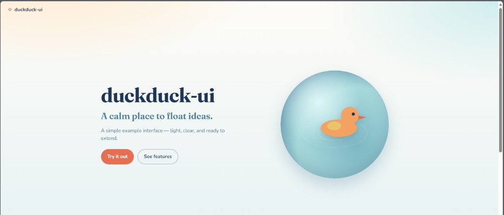

# duckduck-ui

A simple example web UI — light, clear, and ready to extend.

## Run

Open `index.html` in your browser.

## Files

- `index.html` — page structure
- `styles.css` — layout and visuals
- `script.js` — “Try it out” dialog
